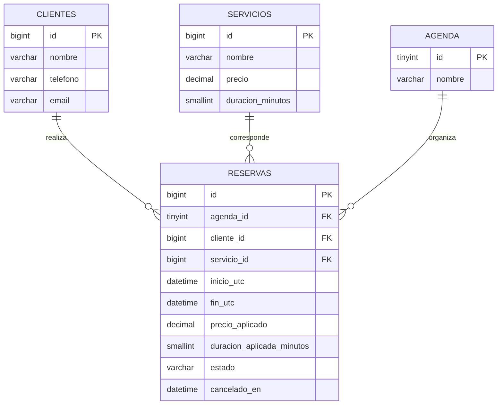

# Modelo de datos — ACT-04

## Relaciones

- Un cliente puede tener muchas reservas.
- Un servicio puede estar asociado a muchas reservas.
- Una agenda contiene muchas reservas.
- Cada reserva pertenece a un cliente, un servicio y una agenda.

## Diccionario resumido

| Tabla | Campos principales | Restricciones |
|---|---|---|
| clientes | id, nombre, telefono, email, creado_en, actualizado_en | Nombre y teléfono obligatorios y no vacíos |
| servicios | id, nombre, precio, duracion_minutos, creado_en | Precio no negativo y duración positiva |
| agenda | id, nombre | Única agenda con id 1 |
| reservas | id, agenda_id, cliente_id, servicio_id, inicio_utc, fin_utc, precio_aplicado, duracion_aplicada_minutos, estado, creado_en, cancelado_en | Claves foráneas, intervalo y duración coherentes, estado válido y cancelación consistente |

## Decisiones

- Motor InnoDB y codificación utf8mb4.
- Importes DECIMAL(10,2).
- Fechas almacenadas en UTC.
- Precio y duración copiados a la reserva para conservar sus condiciones.
- No se eliminan reservas canceladas.
- Las claves foráneas impiden referencias inexistentes.
- El registro de intervalos sin superposición requiere la transacción
  de agenda prevista para ACT-07; no lo garantiza únicamente el esquema.

## Evidencia observada

- Esquema ejecutado en MySQL 8.0.46.
- Fila de agenda principal consultada correctamente.
- Restricciones de estado y cancelación verificadas con ENFORCED=YES.
- Operador BINARY sustituido por CAST para corregir advertencias.
- Cuenta reservas_app con SELECT, INSERT y UPDATE sobre el esquema.
- Archivo .env excluido de Git.
- Diagnóstico Flask check-db satisfactorio:
  database=sistema_reservas; user=reservas_app@localhost;
  timezone=+00:00; agenda=1.

## Diagrama entidad-relación

## Verificaciones pendientes

Disponibilidad y concurrencia se verificarán en ACT-07.
El aislamiento de pruebas en un esquema separado y la persistencia
tras reinicio todavía no se han comprobado.

## Pruebas de integridad ejecutadas — 20/10/2026

Archivo: tests/test_integridad_bd.py.

Resultado: cinco pruebas ejecutadas, todas satisfactorias.

- Registro válido y cancelación con fecha.
- Rechazo de duración cero.
- Rechazo de precio negativo.
- Rechazo de cliente inexistente, conservando la relación original.
- Rechazo de cancelación sin fecha.

El servidor devolvió 1216 y SQLSTATE 23000 para la referencia inválida.
La prueba se ajustó para admitir los códigos 1216 y 1452,
verificando además que la reserva permaneciera sin cambios.

Las pruebas utilizaron transacciones con rollback sobre
sistema_reservas; todavía no utilizan un esquema de pruebas separado.
Los contadores autoincrementales pueden avanzar.

La disponibilidad, concurrencia y persistencia tras reinicio
no quedan acreditadas por estas cinco pruebas.